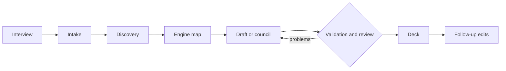

# Ring

Ring builds Commander decks for Magic: The Gathering from a few words. Name a commander,
describe the deck you want, answer a few questions about playstyle, and a team of agents
searches the card pool, maps the deck's engine, drafts it, and checks it before you see it.

**Models propose, code decides.** A model reads your words and picks cards; code checks every
answer against the real card data and the rules. A weak model makes a weaker deck, never an
illegal one that passes.

- **Interview and quoted asks.** Ring asks about playstyle, then keeps your exact words in
  front of every agent and checks the finished deck serves each of them.
- **Local card search.** Scryfall's card data, tags and rulings and Commander Spellbook's combos
  are downloaded once, so a 1,000-card candidate pool builds in about two seconds.
- **Engine map and council.** A model traces the deck's resource loop; an orchestrator and three
  members draft in parallel and debate only the cards they disagree on.
- **Checked results.** Legality, a code-built mana base, a bracket review, and rules answers
  that must quote the Comprehensive Rules they rely on.
- **Follow-ups.** Ask about the deck or for changes; every swap is checked again and saved as a
  new version.



## Quick start

Requires Python 3.10 or newer.

```sh
git clone https://github.com/ToonLink123/MTG-Agentic-AI.git
cd MTG-Agentic-AI
python -m pip install -e ".[tui,embeddings,claude]"
python -m mtg_agentic tui --provider claude
```

On its first start, Ring downloads what it reads locally, about 2.3 GB, with a checklist
(run `python -m mtg_agentic setup` to do it ahead of time). Then type a commander's name and
describe your deck.

For Claude, put `CLAUDE_API=<your key>` in a `.env` file at the repository root; it is ignored
by Git. To stay free and offline, skip `--provider claude` and use a local model through
[Ollama](https://ollama.com) (`ollama pull qwen2.5:7b`).

## Models

| Provider | Runs on | Default model | Candidate pool |
| --- | --- | --- | --- |
| `ollama` (default) | Your machine | `qwen2.5:7b` | 350 cards |
| `llama-cpp` | Your machine | LFM3 1.7B | 350 cards |
| `claude` | Anthropic's API | `claude-haiku-5-5`; the council uses Sonnet 5.5 to lead | 1,000 cards |
| `openai-compatible` | Any compatible API | the one you name | 350 cards |

Rules embeddings always run locally with Google's EmbeddingGemma 2.

## Terminal app and command line

The terminal app is a chat with live progress, session tabs (Ctrl+N, F6) and `/help` for its
commands. Every step it runs is also a command you can run yourself, each reading the file the
last one wrote:

```sh
python -m mtg_agentic intake --commander "Jodah, Archmage Eternal" --request "Bracket 3 Myojin tribal" --output spec.json
python -m mtg_agentic discover --spec spec.json --output pool.json
python -m mtg_agentic engine-map --pool pool.json --output mapped.json
python -m mtg_agentic council --pool mapped.json --provider claude --output deck.json
```

Results are JSON, files are never overwritten, and `validate` exits with `1` for a deck that
fails its checks. [`examples/`](examples) has a spec, a deck that fails on purpose, and a Forge
pod. Optional [Forge](https://github.com/Card-Forge/forge) simulation, a four-deck evaluation
suite and simulation-driven revisions are also built in.

## Development

```sh
python -m unittest discover -s tests -v
```

The tests need no network, downloads or model. [BENCHMARK.md](BENCHMARK.md) explains how rules
retrieval is measured.

## Credits

Card data and rulings come from [Scryfall](https://scryfall.com); card names and text belong to
Wizards of the Coast. Combos come from [Commander Spellbook](https://commanderspellbook.com),
the [Comprehensive Rules](https://magic.wizards.com/en/rules) from Wizards of the Coast, and
rules embeddings use [EmbeddingGemma 2](https://huggingface.co/google/embeddinggemma-2).
